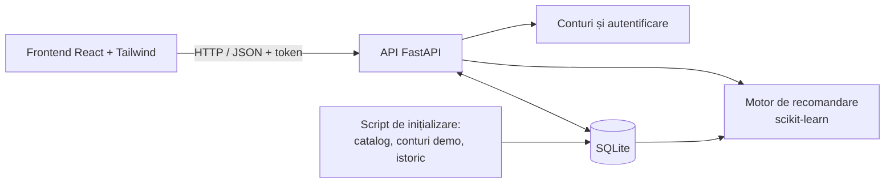

**Propunere pentru Tema VI — Sistem de recomandare + aplicație de test**

Construim **HobbyShop**, un magazin online demonstrativ de echipament pentru drumeție, camping, alergare și ciclism. Fiecare utilizator are un cont și un profil cu preferințele lui, iar aplicația îi recomandă produse **pe baza datelor din profil**, completate de ce vede, salvează și cumpără în aplicație. Fiecare recomandare vine cu o explicație.

Stiva aleasă:

| Componentă | Tehnologie | Rol |
|---|---|---|
| Frontend | **React** (Vite, JavaScript) + **Tailwind CSS** | Conturi, setări de profil, catalog, recomandări, pagina de evaluare |
| Backend | **FastAPI** + **scikit-learn** | API, autentificare, motorul de recomandare, evaluarea |
| Bază de date | **SQLite** | Conturi, profiluri, catalog, interacțiuni, într-un singur fișier local |

Proiectul este realizat în echipă de două persoane, Cristian și Suhan, cu munca împărțită aproximativ egal. Codul este în [ANDYGAB04/Sistem_De_Recomandare](https://github.com/ANDYGAB04/Sistem_De_Recomandare), iar task-urile sunt în proiectul Linear „Sistem-de-Recomandare”.

Documentul de față este o propunere: funcționalitățile și etapele de mai jos nu sunt cerințe suplimentare ale profesorului și nu reprezintă o implementare deja realizată.

## Cerințe

Enunțul din [TemaProiect.txt](TemaProiect.txt) corespunde **temei pentru acasă de la laborator**. Partea teoretică valorează 30%, iar aplicația/demo-ul 70%. Prezentarea de laborator menționează săptămâna III pentru alegerea temei și săptămâna XI pentru susținere fără penalizare. [Sursa: prezentarea de laborator](<materiale-markdown/1. Informatii generale - laborator.md>).

La laborator s-au precizat trei cerințe ([Observatii-Laborator.txt](Observatii-Laborator.txt)):

1. **Recomandarea se face pe baza datelor despre utilizator**, adică pe baza profilului său.
2. **Două conturi cu date complet diferite**, care trebuie să primească recomandări vizibil diferite.
3. **Posibilitatea de a crea de la zero un cont nou** și de a-i completa setările, ca să verificăm în fața profesorului că aplicația funcționează corect.

## Legătura cu cursurile

| Material | Utilizare în proiect |
|---|---|
| Cap. 1 — noțiuni generale | Contextul unui catalog comercial și al interacțiunilor de cumpărare. |
| Cap. 2 — modele de afaceri | Magazin B2C; avantaj propus: descoperirea mai ușoară a produselor potrivite. |
| Cap. 3 — recomandări | Baza tehnică: profilul utilizatorului, caracteristicile produselor, feedback explicit și implicit, filtrarea bazată pe conținut, utilizatorul nou. |
| Cap. 4 — abordare tehnică | Arhitectură client–server simplă și interfață ușor de folosit. |
| Cap. 5–6 — lansare și KPI | Testarea fluxului și alegerea indicatorilor; separarea metricilor algoritmului de rezultatele comerciale. |
| Cap. 7 — marketing | Interacțiunile utilizatorului drept indicii despre interesele sale. |
| Cap. 8 — licitații | Context pentru alte modele comerciale; nu este necesar pentru Tema VI. |
| Cap. 9 — încredere și reputație | Motive de recomandare verificabile; conturi protejate prin parolă. |

## Profilul utilizatorului

Profilul are două surse de date.

**Date declarate**, completate la crearea contului și modificabile oricând din pagina de setări:

| Câmp | Valori |
|---|---|
| Activități preferate | drumeție, camping, alergare, ciclism; fiecare cu intensitate: puțin / mult |
| Nivel de experiență | începător, intermediar, avansat |
| Stil de echipament | ultraușor, confort, rezistență, performanță, buget redus (selecție multiplă) |
| Sezon | vară, iarnă, tot anul |
| Buget maxim per produs | sumă în lei |

**Date de comportament**: produsele vizualizate, salvate la favorite și cumpărate (cumpărare simulată).

Câmpurile declarate se traduc în aceleași caracteristici ca produsele. De exemplu, „ciclism” devine utilizarea `ciclism`, „ultraușor” devine eticheta `ultraușor`, iar nivelul „începător” se potrivește cu produsele etichetate pentru începători. Bugetul nu intră în vector: este un filtru aplicat listei.

## Motorul de recomandare

Fiecare produs are un vector construit din categorie, utilizări și etichete, la care se poate adăuga TF-IDF pe descriere. În scikit-learn folosim `DictVectorizer`, `TfidfVectorizer` și `cosine_similarity`. [Extragerea caracteristicilor](https://scikit-learn.org/stable/modules/feature_extraction.html), [similaritatea cosinus](https://scikit-learn.org/stable/modules/generated/sklearn.metrics.pairwise.cosine_similarity.html).

Profilul utilizatorului combină cele două surse:

`profil_declarat(u) = normalizează(vectorul preferințelor din setări)`

`profil_comportament(u) = normalizează(Σ pondere(eveniment) × vector(produs))`

`profil(u) = normalizează(α × profil_declarat(u) + (1 − α) × profil_comportament(u))`

`scor(u, produs) = cosinus(profil(u), vector(produs))`

- Ponderile evenimentelor pornesc de la valorile din curs: **vizualizare = 1, favorit = 5, cumpărare = 10**. Vizualizările repetate ale aceluiași produs se limitează, ca refresh-urile să nu domine profilul.
- Pentru un cont nou, fără istoric, profilul este format doar din datele declarate. Recomandările personalizate apar imediat după completarea setărilor, fără să aștepte interacțiuni.
- Ponderea α a datelor declarate este o ipoteză inițială, de exemplu 0,5. O verificăm în evaluare.
- Dacă profilul este gol (setări necompletate și niciun istoric), folosim produsele cele mai cumpărate, marcate explicit ca atare.
- Excludem produsele deja cumpărate, produsele indisponibile, produsul deschis în pagină și produsele peste buget.

Fiecare recomandare are o explicație derivată din caracteristicile care au contribuit efectiv la scor. De exemplu: „Pentru că ai ales ciclism și echipament ultraușor; seamănă cu Casca X pe care ai salvat-o”. [Capitolul 3](<materiale-markdown/Cursuri/Comert Electronic Cap-3 - Sisteme de recomandare pentru comert electronic.md>), [filtrarea bazată pe conținut](https://developers.google.com/machine-learning/recommendation/content-based/basics).

Extensia opțională, dacă timpul permite, este filtrarea colaborativă item–item, combinată cu componenta bazată pe conținut.

## Arhitectura

Frontendul nu accesează baza de date; folosește doar API-ul. FastAPI generează automat documentația interactivă (`/docs`), utilă și la susținere. [FastAPI](https://fastapi.tiangolo.com/), [FastAPI și baze de date SQL](https://fastapi.tiangolo.com/tutorial/sql-databases/), [React cu Vite](https://react.dev/learn/build-a-react-app-from-scratch), [Tailwind CSS cu Vite](https://tailwindcss.com/docs/installation/using-vite).

Conturile folosesc e-mail și parolă. Parolele se salvează doar ca hash, iar API-ul emite un token pe care frontendul îl trimite la fiecare cerere. Aplicația este un demo local, așa că nu tratăm recuperarea parolei sau confirmarea e-mailului.

Tabelele din SQLite:

| Tabelă | Conținut |
|---|---|
| `users` | e-mail (unic), hash-ul parolei, nume afișat, data creării |
| `user_profiles` | datele declarate: activități, nivel, stiluri, sezon, buget |
| `products` | catalogul: categorie, utilizări, etichete, descriere, preț, disponibilitate |
| `interactions` | identificator unic de eveniment, utilizator, produs, tip, moment |
| `favorites` | starea curentă a favoritelor |

Cheile externe și constrângerile de unicitate resping evenimentele duplicate și referințele invalide. În SQLite, verificarea cheilor externe trebuie activată pe fiecare conexiune cu `PRAGMA foreign_keys = ON`. [Cheile externe în SQLite](https://www.sqlite.org/foreignkeys.html).

Principalele endpoint-uri:

| Endpoint | Rol |
|---|---|
| `POST /auth/register`, `POST /auth/login`, `GET /auth/me` | Creare cont, autentificare, contul curent |
| `GET /profile`, `PUT /profile` | Citirea și salvarea setărilor de profil |
| `GET /products`, `GET /products/{id}` | Catalog cu filtre, detaliu produs |
| `POST /interactions` | Vizualizare, favorit, cumpărare simulată |
| `GET /recommendations`, `GET /products/{id}/similar` | Recomandări personalizate cu explicații, produse similare |
| `GET /evaluation` | Rezultatele evaluării offline |

## Date de test

Scriptul de inițializare creează, cu seed fix:

- un catalog de aproximativ 100–150 de produse, etichetate ca date de test;
- **două conturi demonstrative cu date complet diferite**, de exemplu:
  - **Maria:** alergare urbană, începătoare, vară, buget redus, istoric doar cu produse de alergare;
  - **Radu:** camping și drumeție de iarnă, avansat, rezistență, buget mare, istoric doar cu produse de camping și drumeție;
- clienți simulați cu istoric, folosiți pentru popularitate și pentru evaluare.

Cele două conturi nu au nicio activitate, niciun stil și niciun sezon în comun. Recomandările lor trebuie să nu aibă niciun produs comun.

**Rezultatele pe date sintetice descriu comportamentul simulatorului; nu dovedesc preferințe reale sau creșterea vânzărilor.**

## Evaluare

Comparăm popularitatea cu recomandarea bazată pe profil, pe aceiași utilizatori și aceleași produse candidate. Folosim praguri cronologice comune pentru antrenare, validare și test. Profilurile și popularitatea se construiesc numai din trecut, iar ponderile (inclusiv α) se aleg pe validare. „Relevant” înseamnă un produs cumpărat în intervalul de test.

| Indicator | Ce arată |
|---|---|
| Precision@5 | Proporția produselor relevante între primele cinci recomandări. |
| Recall@5 | Proporția produselor relevante din test recuperate în primele cinci. |
| Acoperirea catalogului | Cât din catalog apare în recomandări pentru utilizatorii evaluați. |
| Timp de răspuns | Cât durează obținerea listei pe mașina și catalogul testate. |

Raportăm separat utilizatorii fără istoric și pe cei fără produse relevante în test. Rata de conversie sau creșterea vânzărilor ar necesita observații reale; KPI-urile din [capitolul 6](<materiale-markdown/Cursuri/Comert Electronic Cap-6 - KPIs.md>) pot fi prezentate ca obiective viitoare.

## Etape

1. **Fundație:** structura repository-ului, scheletele frontend și backend, schema SQLite.
2. **Conturi și catalog:** înregistrare, autentificare, setări de profil, catalog, interacțiuni.
3. **Recomandări:** motorul bazat pe profil, explicațiile, conturile demonstrative, paginile de recomandări.
4. **Evaluare și prezentare:** evaluarea offline, testarea fluxului complet, prezentarea și scenariul de demo.

Fiecare persoană lucrează atât pe backend, cât și pe frontend:

- **Suhan:** conturi și autentificare, setările de profil, catalogul și interacțiunile, testarea fluxului complet.
- **Cristian:** structura proiectului, schema bazei de date, motorul de recomandare, conturile demonstrative, evaluarea.

Prezentarea se împarte în două jumătăți, câte una de fiecare. Împărțirea detaliată, cu estimări, este în Linear.

## Scenariul de demonstrație (~5 minute)

1. Te autentifici ca **Maria**: recomandări de alergare, ieftine, pentru vară, cu explicații.
2. Te autentifici ca **Radu**: recomandări complet diferite, de camping și drumeție de iarnă.
3. **Creezi un cont nou de la zero**, de exemplu cu ciclism, nivel intermediar și stil ultraușor. Recomandările apar imediat după salvarea setărilor.
4. Schimbi o setare, de exemplu bugetul sau o activitate, și lista se actualizează.
5. Deschizi câteva produse și adaugi unul la favorite: lista se adaptează și după comportament.
6. Închei cu evaluarea față de popularitate și cu limitele datelor sintetice.

Pentru componenta teoretică propunem 8–10 slide-uri: problema comercială, profilul utilizatorului, filtrarea bazată pe conținut față de cea colaborativă, datele, scorul, arhitectura, evaluarea, demonstrația și limitele. Un titlu potrivit ar fi **„Sistem de recomandare explicabil pentru produse de comerț electronic, bazat pe profilul utilizatorului”**.
